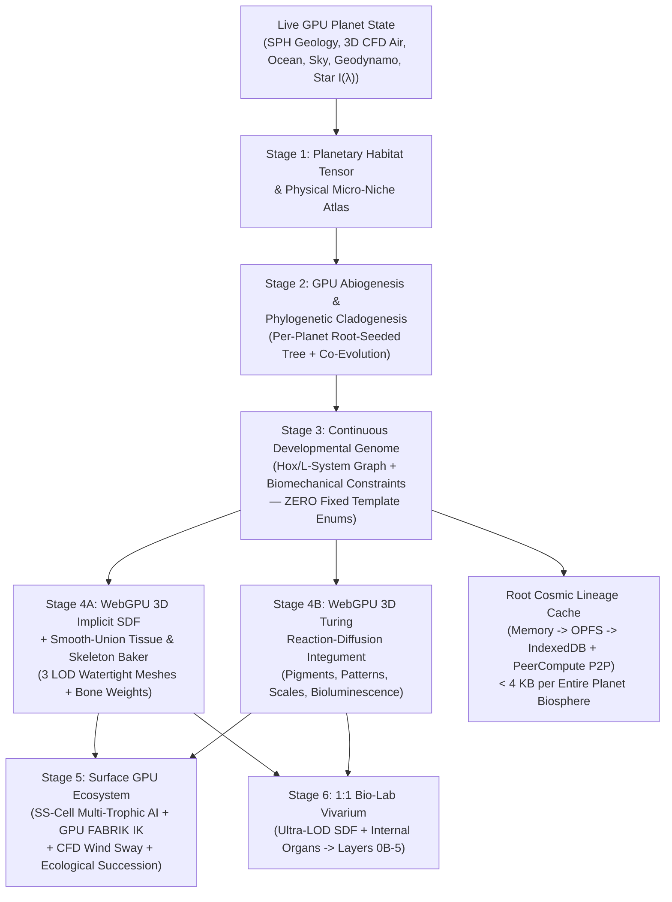

# Emergent First-Principles Alien Ecosystems & Morphologically Unique Complex Life Plan

> **Authority:** Active post-Wave-1 flagship biology & planetary surface roadmap in `plan/todo/` (indexed in [`plan/todo/README.md`](README.md)).
> **Directive (`big dog`, 2026-11-27):** *"create a robust plan for how you should emergently generate ecosystems and complex unique life for each planet that supports life. no two species should be visually identical between planets they should be created from scratch to suit that environment exactly."*
> **Core Rule (Star Spec v0.4 + GPU-Native):** Zero hardcoded planet/species presets, zero shared static mesh template menus reused across worlds, zero sinusoidal walk-cycle fakes, zero CPU per-frame mesh-GC churn. Every species' anatomy, skeletal mechanics, integument, pigmentation, sensory organs, locomotion, and trophic behavior must **emerge from scratch** on WebGPU from its planet's live physical environment and unique evolutionary phylogeny.

---

## 0. Honest Gap Analysis: Why Today's Engine Still Repeats Visual Archetypes

ULG already has a strong scientific foundation for planetary astrobiology (`xenobiologyEcologyEngine.js`, `xenobiologySynthesizer.js`, `organismBiochemistryGenerator.js`, `morphogenesisActiveMatterGpu.js`) and 1:1 surface-to-Bio-Lab specimen transport (`planetarySurfaceVehiclesGpu.js` ↔ `lifeLabDemo.js`). However, two structural bottlenecks currently prevent true per-planet morphological uniqueness:

1. **Finite Hardcoded Mesh Template Menus:**
   - `src/runtime/biology/xenobiologyAnatomyMesh.js` selects from **17 fixed procedural body-plan switches** (`BODY_PLAN_IDS`: 8 fauna, 6 flora, 3 fungi) assembled on the CPU out of simple `pushSegmentTube` / `pushEllipsoid` primitives.
   - `src/runtime/astrophysics/surfaceFloraPlacementGpu.js` instances **6 fixed flora template IDs** (`0..5`) across all worlds.
   - **Consequence:** Two different habitable worlds with similar `(g, T, P)` end up instantiating visibly recognizable variants of the *same* quadruped, hexapod, conifer, or branching-arbor mesh painted different colors.
2. **Static Uncoupled Surface Behavior & CPU Skinning:**
   - Surface fauna currently wander along simple loops without multi-trophic predator–prey foraging, niche partitioning, IK terrain foot placement, or ecological coupling to live SPH biomes/moisture/wind/day-night cycles.
   - Vivarium geometry is rebuilt on the CPU each frame instead of baking GPU-resident skinned meshes from a developmental genome.

**Architectural Goal:** Retire all fixed `BODY_PLAN_IDS` / 6-flora-template switches and replace them with a **6-stage, WebGPU-native Evolutionary Phylogeny → Developmental Genome → 3D SDF/Turing Morphogenesis → GPU Skinned IK & Multi-Trophic Ecosystem** pipeline.

---

## 1. End-to-End Architecture Overview

---

## 2. Stage-by-Stage Engineering Specification

### Stage 1 — Planetary Habitat Tensor & Physical Micro-Niche Atlas
**Files:** `src/runtime/biology/planetaryNicheAtlas.js` *(new)*, integrating `planetaryGenesisSphGpu.js`, `planetaryAtmosphere3dCfdGpu.js`, `surfaceCelestialSkyAndSeasons.js`, `xenobiologyEcologyEngine.js`.

- Extract a continuous **Planetary Habitat Tensor $\mathbf{E}_{\text{planet}}$** strictly from live GPU simulation state (never hardcoded by planet name):
  - **Gravity & Mechanics:** $g$ (`m/s²`), rotational Coriolis parameter $f = 2\Omega\sin\phi$, diurnal period & obliquity/season amplitude, tidal locking flag & substellar-to-terminator $\Delta T$.
  - **Fluid & Atmospheric Medium:** Solvent identity & properties from Bains–Petkowski–Seager (2024) ($T_m, T_b, \varepsilon_r, \eta_{\text{solv}}, \rho_{\text{solv}}$), atmospheric density $\rho_{\text{atm}}$, surface pressure $P$, dynamic viscosity $\mu_{\text{atm}}$, and 3D CFD wind-speed distribution $(v_{\text{mean}}, v_{\text{gust}})$.
  - **Radiative & Electromagnetic Environment:** Host-star Planck spectrum filtered through live atmospheric Rayleigh + molecular absorption bands $I(\lambda)$, peak PAR/NIR flux, UV/ionizing radiation dose (driving Eigen mutation rate $\mu$ & radiation shielding), and live planetary Geodynamo dipole $B_0$.
  - **Geochemical & Redox Substrates:** Crust mineralogy (`Fe, Si, Ca, Mg, C, S, P` from L2 nebular coalescence + L4 SPH differentiation), hydrothermal/volcanic heat-flux fraction, ocean coverage & depth profile, and available Gibbs redox couples $\Delta G_{\text{redox}}$ (kJ/mol $e^-$).
- Partition each viable world dynamically into **`4–8` physical micro-niches** (e.g., *euphotic shoreline*, *wind-scoured highland*, *shaded lowland basin*, *hydrothermal volcanic rift*, *abyssal/subsurface brine*, *buoyant baroclinic cloud deck*, *twilight terminator ring*). Sterile worlds (`biosphereViability < 0.15`, vacuum/magma) produce **exact `0` niches and `0` organisms**.

---

### Stage 2 — Per-Planet Abiogenesis & GPU Phylogenetic Cladogenesis Engine
**Files:** `src/runtime/biology/evolutionaryCladogenesisGpu.js` *(new)*, upgrading `xenobiologyEcologyEngine.js` & `organismBiochemistryGenerator.js`.

Rather than picking unrelated species out of a catalog, **every life-bearing planet evolves its own private Tree of Life from scratch** in `< 40 ms` on WebGPU (seeded deterministically by `(universeSeed, galaxyCoord, starSeed, bodySeed)` and cached in `cosmicLineageRootCache.js`):

1. **Planetary Abiogenesis Root (LUCA):**
   - Synthesizes the planet's unique basal biochemistry via `organismBiochemistryGenerator.js`: solvent-compatible membrane amphiphiles (phospholipids, tetraether monolayers, azotosomes, sulfated aerosols), `4–12` letter XNA genetic alphabet & Eigen error threshold $\mu_{\text{crit}} = \ln(s)/L$, chirality sign (`L` vs `D`), and primary biomineral scaffold (`CaCO3` / hydroxyapatite, `SiO2` opal/quartz, chitin/keratin polymer, `FeS2`/magnetite armor, or cryogenic water-ice/hydrocarbon crystals).
2. **Early Body-Plan Symmetry Radiation (Unique Phyla Per World):**
   - Each planet's basal multicellular lineages radiate along **continuous developmental symmetry & structural axes** — guaranteeing distinct macroscopic "alien phyla" between worlds:
     - **Body Symmetry Order $S$:** Continuous-probability radiation across bilateral ($S=2$), triradial ($S=3$), tetraradial ($S=4$), pentaradial ($S=5$), hexaradial ($S=6$), helical/chiral spiral, colonial-modular, or fluid syncytial forms.
     - **Structural Support Mode:** Selected continuously by mechanical optimality under $(g, P, \rho_{\text{fluid}}, E_{\text{mineral}})$: internal articulated endoskeleton, segmented exoskeleton, hydrostatic turgor bellows, tensegrity struts, buoyant gas-filled bladders ($\Delta\rho = \rho_{\text{atm}} - \rho_{\text{lift}}$), or rooted mineral-lattice stalks.
     - **Locomotion & Transport Physics:** Evaluated strictly by dimensionless numbers — **Reynolds ($\text{Re}$), Froude ($\text{Fr}$), Strouhal ($\text{St} \in [0.2, 0.4]$), Wing Loading ($W/S \propto g/\rho_{\text{atm}}$), and Cost of Transport ($\text{COT}$)**:
       - High-$g$ worlds favor low center-of-mass wide-stance multi-limbed gaits ($4, 6, 8+$ sturdy pillared limbs), peristaltic/armored crawlers, or low spreading mats.
       - Low-$g$ / dense-air worlds naturally radiate tall slender cantilevered spires, elastic jumpers, membranous gliders, flapping flyers, and lighter-than-air buoyant aero-organisms.
       - Aquatic / subsurface-ocean worlds radiate undulatory ribbon swimmers, jet-siphon cephalopod-analogues, hydrofoil swimmers, and benthic stalked filter-feeders.
3. **Co-Evolutionary Multi-Trophic Radiations (Lotka–Volterra + Red Queen Selection):**
   - Simulates `~200` coupled macro-evolutionary epochs allocating biomass across the planet's micro-niches under **Lindeman's ~10% trophic transfer efficiency** and **Kleiber allometry ($P \propto M^{0.75} Q_{10}^{(T-T_{\text{ref}})/10}$)**:
     - **Primary Producers (`4–6` unique lineages per world):** Phototrophs (pigment absorption solved from exact host-star $I(\lambda)$ × atmospheric windows — black/deep-crimson NIR leaves under M-dwarfs, golden-emerald under G-stars, violet-cyan/UV-shielded under F-stars), chemolithotrophs clustered near SPH volcanic/tectonic faults, and detrital/mycelial decomposers.
     - **Primary Consumers (`3–5` unique lineages):** Grazers, canopy browsers, nectar/spore mutualists, benthic/aerial filterers.
     - **Secondary/Apex Predators & Symbionts (`2–4` unique lineages):** Pursuit hunters, camouflage ambushers, pack/swarm coordinators, bioluminescent lure predators.
   - **Co-Evolutionary Trait Coupling:** Predator speed drives prey armor, spines, camouflage Turing frequencies, herd flocking, or toxicity/aposematic contrast; canopy height drives browser neck/proboscis/climbing limb evolution; atmospheric opacity & daylight fraction drive sensory organ evolution (multi-lens/compound eyes, acoustic dish-horns in dense air, IR thermoreceptor pits on M-dwarf worlds, electroreceptive barbels in conductive brines).

---

### Stage 3 — Continuous Developmental Genome (`ulg.biology.developmental-genome.v1`, ZERO Fixed Template Enums!)
**Files:** `src/runtime/biology/developmentalGenome.js` *(new)*.

Every evolved species is serialized into a compact, deterministic **`~512`-byte Developmental Genome** that encodes *how the organism grows* from an embryo/seed — **zero enum IDs like `'quadruped-cursorial'` or `'conifer-spire'`**:

1. **Axial Hox-Segment / Vascular L-System Directed Acyclic Graph (`8–24` Developmental Modules):**
   - **Spine / Trunk / Axis Curve:** Number of metameres $N_{\text{seg}} \in [1..14]$, 3D spline curvature, dorsal/ventral eccentricity, vertebral stiffness, and dorsal sail/ridge/crest profile (Bergmann/Allen surface-area-to-volume thermal radiator sizing!).
   - **Symmetry & Appendage Attachment Grammar:** Symmetry fold $S$, bilateral/radial/helical whorl angles, phyllotaxis divergence angle (e.g., golden angle $137.5^\circ$, Fibonacci spirals, opposite decussate, asymmetric wind-streamlined leeward sweep), recursive sub-branching depth ($1..4$), and Murray's Law radius taper ($r_{\text{parent}}^3 = \sum r_{\text{child}}^3$) bounded by **Euler column buckling** $H_{\max} \propto (E / (\rho g))^{1/3}$ and **aerodynamic wind bending moment** $\rho_{\text{atm}} v_{\text{wind}}^2$.
   - **Articulated Limb / Fin / Wing / Tentacle Kinematics:** Joint count ($1..5$ segments per appendage), joint hinge axes, footpad/claw/hoof/sucker/webbed-fin terminal effector, muscle cross-section scaling ($\propto g \cdot M$), and exact **Center-of-Mass & Support-Polygon Balance Check** (automatically tunes body posture, counterbalancing tail mass, and stance width so every terrestrial organism stands & walks stably!).
   - **Cranial / Sensory / Feeding Complex:** Sensory organ cluster count & placement (stalked, recessed, ring-mounted around radial hub, or forward binocular), aperture size scaled to local photon flux $I_{\text{local}}$, feeding apparatus geometry (articulated mandibles, tubular proboscis, radiating filter-fan, beak, extensible jaw), and respiratory structures (external feathery gill plumes, pulsing thoracic spiracles, inflating gas-sac chambers).
   - **Foliage / Frond / Membrane / Bladder Collectors (Autotrophs & Fungi):** Continuous parametric collector geometry — ribbon blades, fenestrated discs, translucent honeycomb domes, spiral ribbons, branching coral-like crystal fans, translucent buoyant lifting sacs, or ribbed spore-gills — sized to photon flux and water/solvent conservation (narrow waxy needles/spines in arid deserts; wide thin light-trapping sheets in dim canopies).
2. **Developmental Tissue & Integument Parameters:**
   - **Smooth-Union Tissue Blend Radius $k_{\text{blend}}$:** Soft muscular/hydrostatic organic blending vs sharp segmented carapace plates & osteoderm ridges.
   - **3D Turing Morphogenesis Seed $(F, k, D_u, D_v, \text{anisotropy}, \text{scale})$:** Generates unique species-level spots, stripes, marbling, labyrinth veins, or ringed bands directly in 3D object space.
   - **Optical & Spectral Reflectance Profile:** Primary/secondary/accent chromophores derived from photobiology + camouflage against local SPH soil/flora RGB + structural iridescence thin-film thickness $d_{\text{film}}$ + bioluminescence luciferin $\lambda_{\text{emit}}$ & pore distribution.

---

### Stage 4 — WebGPU 3D Implicit SDF Morphogenesis Baker & Turing Skin Synthesizer
**Files:** `src/runtime/biology/organismSdfMorphogenesisGpu.js` *(new)*, extending `src/runtime/biology/morphogenesisActiveMatterGpu.js`.

**No CPU triangle pushing (`pushSegmentTube`/`pushEllipsoid`)!** Every species' Developmental Genome is compiled directly on the GPU into unique, smooth, organic, articulated 3D geometry in `< 2 ms` per species:

1. **GPU 3D Implicit SDF & Bone-Weight Evaluator (`@workgroup_size(4, 4, 4)`):**
   - Evaluates the species' developmental graph into a 3D grid (`40³` for surface LOD0, `24³` for surface LOD1, `96³` for Bio-Lab Vivarium close-up!):
     - **Smooth-Minimum Organic Capsules & Metaballs** (`smin_poly(d1, d2, k_blend)`) for torso segments, neck, musculature, gas bladders, and trunks;
     - **Sharp / Creased Carapace & Exoskeleton Plates** (`max` / chamfered SDF unions + ribbed chitin folds) for armored/high-$g$/predator lineages;
     - **Thin-Sheet Fins, Wings, Fronds, Sails & Gill Plumes** (warped parametric SDF slabs with sinusoidal/veined thickness modulation);
     - **Sensory Bulbs, Bioluminescent Pores, Spines & Feeding Appendages** placed at exact anatomical sockets.
   - Simultaneously writes **per-voxel closest skeletal bone IDs + smooth skinning weights `(b0, b1, w0, w1)`** AND **anatomical organ-zone ID** (`head/sensory`, `thorax/metabolic`, `limb/locomotion`, `respiratory/sail`, `reproductive/canopy`, `biolum-organ`) for instant 1-tap Bio-Lab organ dissection!
2. **GPU Dual-Contouring / Surface-Nets Isosurface Mesh Extractor (`WebGPU Compute`):**
   - Parallel GPU Surface-Nets extraction converts the SDF volume into a **watertight, indexed GPU vertex + index buffer** (`pos`, exact analytical $\nabla\text{SDF}$ smooth normal, `(bone0, bone1, w0, w1)`, `organZone`, object-space 3D coords for seamless triplanar/volumetric texturing) with **zero CPU readback**!
   - Emits **3 LOD meshes** per species packed cleanly into a single **Per-Planet GPU Species Mesh Atlas** (`<= 12–16 MB` total VRAM for an entire planet's `12–20` unique species!).
3. **GPU 3D/Surface Reaction-Diffusion Integument Pass:**
   - Runs `64` fast coalesced steps of a species-parameterized Gray–Scott / Gierer–Meinhardt Turing PDE on WebGPU (using the fixed per-substep uniform ring from Wave 4 `R2-B2`!), baking a compact `64×64×16` 3D procedural skin/bark/bioluminescence texture tile per species (sampled seamlessly in object space with zero UV seams!).
   - **Guarantee:** Every single species across every planet has a genuinely unique, organic, smooth-blended 3D silhouette, bone hierarchy, organ layout, and Turing-grown surface pattern — **never two identical species across planets!**

---

### Stage 5 — GPU Skinned IK Locomotion & Multi-Trophic Planetary Surface Ecosystem
**Files:** `src/runtime/biology/surfaceEcosystemGpu.js` *(new)*, upgrading `src/runtime/astrophysics/surfaceFloraPlacementGpu.js` & `src/runtime/astrophysics/planetarySurfaceVehiclesGpu.js`.

1. **Retire Fixed 6-Template Flora & Hardcoded Surface Creatures:**
   - `surfaceFloraPlacementGpu.js` binds the planet's freshly baked **GPU Species Mesh Atlas** (each autotroph/fungal species mapped to its exact preferred SPH micro-niche: elevation, slope, moisture/river distance, soil heat, shoreline depth!).
   - Flora instances sway dynamically in the vertex shader driven by live **3D CFD wind velocity vectors** (`planetaryAtmosphere3dCfdGpu.js`), bend slightly phototropically toward the host star, and respond to seasonal snow/dormancy and UFO crater disturbances (gradual pioneer-species ecological succession around craters!).
2. **GPU Multi-Trophic Ecosystem Agent Compute Kernel (`@workgroup_size(64)`, Canonical `SS` Spatial Cells):**
   - Simulates `64–192` live motile fauna agents on the GPU inside canonical spatial cells (zero $O(N^2)$ host loops!):
     - **Sensory Field Queries:** Agents sense nearby flora biomass, solvent shorelines, predators, prey, and conspecifics using species-specific sensory range (reduced in darkness unless equipped with IR/sonar/electroreception/bioluminescence!).
     - **State-Machine-Free Utility Steering:** Continuous biomechanical forces — hunger/foraging gradient, predator flee impulse, prey interception lead-pursuit, conspecific herding/schooling alignment + separation, thermal shade/basking preference, diurnal rest cycles (`sunElevDeg`), and energy conservation (`ATP` reserve depleted by movement $\propto g \cdot v^2$ and replenished by feeding!).
     - **Living Interactions With the Player & UFO:** Curious vs skittish behavioral temperaments derived from trophic level (grazers scatter from approaching UFO/rover; apex predators posture/flare sails or challenge; bioluminescent nocturnal species pulse warning waves; tractor beam abduction lifts live IK-dangling limbs!).
3. **Zero-Fake GPU Skeletal Animation & Terrain Inverse Kinematics:**
   - GPU bone-matrix compute pass (`@workgroup_size(64)`) drives every creature's baked skeleton directly from its physical velocity, turning yaw rate, and terrain slope:
     - **Terrestrial Limbs:** Stride frequency $f = \frac{1}{2\pi}\sqrt{g / L_{\text{leg}}} \cdot \text{Fr}^{0.5}$ with real **2-bone analytical GPU IK** planting feet directly onto the live SPH terrain heightmap!
     - **Swimmers & Flyers:** Traveling body-wave / wing-stroke at Strouhal $\text{St} \in [0.2, 0.4]$ scaled to fluid density $\rho$ and wingbeat lift!
     - **Tentacular / Peristaltic / Radial Forms:** Coupled phase-lagged travelling compression/flexion waves along developmental bone chains!

---

### Stage 6 — 1:1 Bio-Lab Vivarium & Root-Cache / PeerCompute P2P Persistence
**Files:** `src/demos/lifeLabDemo.js`, `src/demos/chemBioWebGpuRenderer.js`, `src/runtime/astrophysics/cosmicLineageRootCache.js`, `src/demos/ulgUniversesPhysics.js`.

- **Identical Specimen Across Surface & Bio-Lab:** Abducting or clicking `🫧 Bio Aquarium ↗` on any planet's alien plant/animal/fungus passes its compact **`~512`-byte Developmental Genome + Habitat Tensor** (via URL/OPFS/state). `life-lab.html` runs the **exact same GPU SDF + Turing Baker** at ultra-high `96³` LOD so the specimen in the aquarium is **100% identical** to the creature roaming that planet's hills!
- **Interactive Anatomical Dissection & Live Reactions:** Clicking any baked `organZone` on the 3D GPU mesh highlights that species' real internal physiology (vascular/respiratory/neural/sensory/metabolic) and lets the user dive straight into Bio-Lab Layers 0B–5 (All-Atom monomer MD, amphiphile membrane, biopolymer folding, XNA replication, bioenergetics, and Turing morphogenesis) parameterized strictly by that organism!
- **Root-Node Lineage Cache & Multiplayer Consistency:** Every planet's evolved biosphere (`~12–20` Developmental Genomes, `< 4 KB` JSON/binary total!) is persisted in `cosmicLineageRootCache.js` (`Memory LRU → OPFS → IndexedDB` + PeerCompute P2P sync). Revisiting a world or exploring alongside multiplayer peers reproduces the **exact same unique alien species** bit-for-bit on every GPU with zero network mesh bloat!

---

## 3. Phased Delivery Roadmap & Acceptance Invariants

| Phase | Deliverables | Key Quantitative & Visual Acceptance Gates (Vulkan) |
|---|---|---|
| **Bio-P1 (Habitat & Cladogenesis)** | `planetaryNicheAtlas.js`, `evolutionaryCladogenesisGpu.js`, `developmentalGenome.js`, root-cache serialization | 12 diverse planets (incl. 2 Earth twins with different seeds) evolve distinct phylogenetic trees, symmetries, and Lindeman trophic pyramids (`< 40 ms` GPU); sterile worlds yield `0` species. |
| **Bio-P2 (GPU SDF & Turing Baker)** | `organismSdfMorphogenesisGpu.js` (SDF + Surface-Nets + bone weights + organ zones + 3D Turing skin); retire 17 fixed `BODY_PLAN_IDS` | `< 60 ms` full-planet species atlas bake (`<= 16 MB` VRAM); **Cross-Planet Uniqueness Gate:** spherical-harmonic SDF shape distance & feature vectors prove **zero identical/near-duplicate silhouettes across planets**; Apple Metal WGSL audit PASS. |
| **Bio-P3 (Surface IK & Multi-Trophic AI)** | `surfaceEcosystemGpu.js`, GPU bone-skinning + terrain IK, wind-coupled multi-species flora atlas replacing fixed 6 templates | `>= 54 FPS` on surface with `1,024` unique flora + `96` IK-animated fauna; verified Euler buckling $H(g)$, Strouhal swimming/flying, foraging/predator-flee trajectories, and sequential Vulkan visual screenshots across 6 distinct alien worlds! |
| **Bio-P4 (1:1 Bio-Lab & P2P Sync)** | Ultra-LOD `96³` Vivarium GPU baker in `life-lab.html`, organ-zone dissection -> Layers 0B–5, PeerCompute genome sync | Abducted surface creature renders identically in Bio-Lab Vivarium (`0` CPU per-frame vertex GC churn); multiplayer peers see identical species on shared planets; `KERNEL_CLEAN`, `ZERO_HEADLESS_CHROME`. |

### Anti-Shortcut & Falsifiable Verification Laws
1. **Cross-Planet Zero-Twin Test:** Evolve biospheres on 12 planets (including two Earth-mass G-star worlds with different seeds/atmospheres). Compute pairwise morphological distance (symmetry order, appendage count/lengths, aspect ratios, SDF spherical-harmonic spectrum, Turing pattern wavenumber, pigment CIE ΔE) and strictly fail if any two inter-planetary species collapse onto the same silhouette!
2. **Gravity & Fluid Scaling Falsification:** Sweeping $g \in [1.5, 25]\text{ m/s}^2$ must monotonically reduce canopy buckling height $H \propto g^{-1/3}$, thicken limb radius-to-length ratio, and shift gait frequency $f \propto \sqrt{g/L}$. Sweeping $\rho_{\text{atm}} \in [0.05, 15]\text{ kg/m}^3$ must monotonically increase aerial/buoyant clade emergence.
3. **Spectral Photobiology Falsification:** Sweeping host star $T_{\text{eff}} \in [2800\text{ K (M-dwarf)}, 5778\text{ K (G2V)}, 7500\text{ K (F-star)}]$ must shift evolved autotroph reflectance spectra continuously without any star-type `if/else` lookup table.
4. **Sterility Null Limit:** Zero-atmosphere vacuum worlds (`P < 500 Pa`) and magma oceans (`T > 950 K`) must produce exact `0` evolved lineages, `0` baked meshes, and `0` surface instances.
