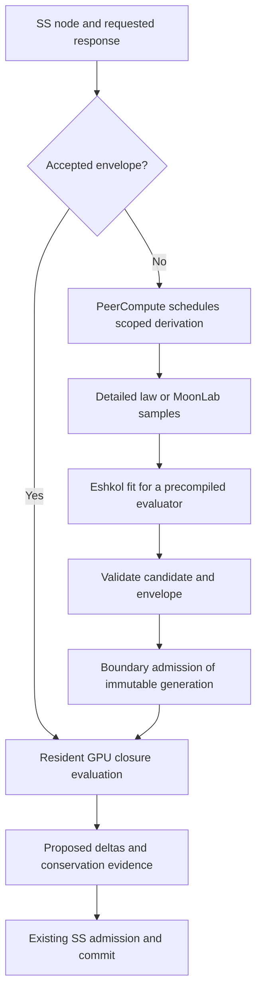

# Eshkol Higher-Order Law And Material Closure Plan

Date: 2026-09-22 AKDT

**2026-11-22 Live-Code Status (`2fe9e47b`, Gate 2 / Gate 3):** P0/P1 wired
`eshkolSample` + `adoptedEosStiffnessBundles` into the worker stiffness table,
wired `eshkolHigherOrderLawCompiler.js` into the worker schedule boundary, and
landed the GPU Chebyshev fitter (`responseFunctionFitGpu.js`). **Remaining:**
retire CPU startup fitters (`gasResponseFunctions`, `eshkolEosStiffness`),
integrate with Gate 2's Convex Polytope Atlas (`ulg.polytope-atlas.v1`), and
pass Gate 3 continuum oracle. Active routing:
[`plan/CURRENT-PLAN.md`](../CURRENT-PLAN.md).

Priority: supports Goals 4–6 and A4/A6. The first
integrated deliverable belongs to Goal 6 / A4; broader compiler and learned-model
work remains subsequent, dependency-gated scope.

## Purpose And Sequencing

Use Eshkol to transform physical law programs into reusable, differentiable
material responses with executable validity envelopes. SS consumes those
responses through its existing spatial authority and law-admission path;
PeerCompute owns scheduling, resource leases, and accepted state mutation.

The higher-order operation is a program accepting a law or law subgraph and
producing another law artifact: specialize, compose, differentiate, coarse-grain,
approximate, validate, and compile. Tables, polynomials, reduced models, and
neural networks are alternative implementations of an explicit response contract.

This develops the online closure factory already specified by the
[scale-adaptive law plan](scale-adaptive-law-activation-plan.md) and the
[material polytope/property-fit plan](material-polytope-registry-and-property-fit-plan.md).
It preserves the [current priority order](README.md): finish the earlier visible
physics and coherent-solid requirements, generalize node activation in Goal 4,
and establish the needed bounded reservations in Goal 5 before integrated
Goal 6 adoption. Schema and compiler investigations may proceed independently
without declaring those runtime dependencies complete.

Assume forthcoming Eshkol WebGPU support as the backend direction. At
implementation time, pin the actual compiler version and verify the supported
numerical subset, derivative orders, precision, and ULG ABI. Backend availability
alone does not establish general GPU AD or arbitrary Scheme execution in shaders.

## Existing Foundations And Gaps

- The [SS Law Adapter Contract](SS/schroeder-tree-and-algorithm-plan.md)
  declares scale/chart assumptions, state reads/writes, exact-near requirements,
  aggregate error bounds, cross-level coupling, conservation, and fallbacks.
  The [architecture assessment](../ss-law-architecture-assessment.md) identifies
  the gap between those declarations and generated, enforced implementations.
- [closureLawGraph.js](../../src/runtime/closureLawGraph.js) currently compiles
  table-interpolation closures. Its independently interpolated value and
  derivative channels need not describe one differentiated interpolant. It is
  not yet a general law-subgraph compiler or resident NN execution system.
- [closureRegimeStore.js](../../src/runtime/closureRegimeStore.js) already
  implements regime keys and invalidation metadata, superseding older inventory
  text that calls it missing. Its admission function checks temperature,
  pressure, and density ranges; storing a `homogeneityTest` does not execute it.
  Its invalidation-key arguments also lack an explicit domain hash; bind the
  domain through a documented input hash or extend the key before relying on it.
- [Dynamic law routing](../../src/runtime/sph/schroederDynamicLawRoutingContract.js)
  provides the reaction activation seed, with shadow routing as the default.
  General per-law envelope activation and the online factory remain work to do.
- The [completed spatial refactor](../done/SS/shared-spatial-authority-refactor-plan.md)
  supplies one canonical GPU spatial generation and derived consumer views.
  New closures must consume that generation rather than construct private grids.

## Law Objects And Higher-Order Transformations

Represent each law as a numerical body plus a machine-readable contract:

- Physical input/output schemas, units, independent state coordinates, and
  nondimensionalization; declare reference configurations for strain and volume.
- Read, write, and accumulate state families; ownership and generation bindings.
- Spatial support, boundary conditions, chart/scale range, ensemble assumptions,
  aggregation admissibility, and unresolved-variable assumptions.
- Conserved quantities, symmetries, dissipation/stability conditions, residuals,
  derivative requirements, error targets, and fallback policy.

Proposed transformations, not existing public Eshkol/ULG APIs:

| Operation | Produced artifact | Required qualification |
| --- | --- | --- |
| Specialize | Smaller law for fixed composition, phase, structure, or parameters | Preserve assumptions and their invalidation dependencies |
| Compose | Coupled response with shared intermediate calculations | Respect effects, units, dependency order, and declared feedback solves |
| Differentiate | Jacobians, tangents, Hessian-vector products, response coefficients | Verify supported AD paths; define implicit or unrolled solver differentiation |
| Coarse-grain | Effective law for unresolved degrees of freedom | Supply ensemble, boundary conditions, scale separation, and closure state |
| Approximate | Table, polynomial, reduced model, or NN | Measure consumer-specific value and derivative errors on a declared domain |
| Compile | GPU evaluators, bindings, envelope predicates, residual reductions, manifests | Pin compiler/ABI/precision and validate the emitted numerical behavior |

Use macros and first-class functions in the derivation/compiler layer. Lower a
bounded numerical kernel subset with explicit storage into WebGPU. Generate
layout accessors and bindings from declarations; do not assume language types
alone prove units, ownership, conservation, or physical correctness.

A subgraph may be replaced behind a declared boundary interface only when the
replacement preserves required outputs, fluxes, memory, and conservation
obligations. Retain the source subgraph and dependency hashes. This changes
execution cost without removing laws or upgrading their scientific evidence.

## Material Response And Envelope Bundle

A response model evaluates behavior. Its envelope declares when that behavior
is admitted. Store both, with at least:

| Field group | Required content |
| --- | --- |
| Identity | Source subgraph/closure IDs and hashes, material/composition identity, phase and structural assumptions |
| Coordinates | Axes, units, normalization, domain topology, independent variables, reference configuration |
| Physical scope | Ensemble, boundary/forcing assumptions, spatial and temporal scales, wavelength/frequency where relevant |
| Closure state | Phase fractions, strain/history/internal variables, microstructure and homogeneity requirements |
| Evaluator | Representation, coefficients/weights, derivative interface, compiler version, GPU ABI, precision |
| Evidence | Sample hashes, training/holdout separation, value/derivative errors, stability and conservation evidence |
| Lifecycle | Envelope predicate, fallback policy, dependency invalidation, immutable generation and adoption identity |

Separate source-method uncertainty, surrogate error, coarse-graining/integration
error, and GPU numerical error. State whether evidence is empirical, local,
statistical, or a justified conservative bound. A sampled residual, Taylor
series, or NN confidence score does not automatically certify a whole domain.

Required admission inputs must be finite and present; missing phase, composition,
history, or homogeneity evidence cannot be treated as a wildcard. Invalidation
must bind source/sample hashes, model parameters, the complete domain and state
assumptions, compiler/tool versions, schema/ABI/precision, and validation evidence.
Document their canonical hash composition so a routing-bucket hit cannot bypass
an incompatible exact envelope or changed source dependency.

Reuse artifacts by physical regime, not scenario name. Partition incompatible
phases, structures, or property-family coverage. Nondimensional reuse across
SS levels requires matching physical similarity assumptions. Material identity
and a T/P/density box alone do not establish applicability across the periodic
table, mixtures, defects, polymorphs, or arbitrary driving conditions.

## Shared Potentials And Consistent Derivatives

For a smooth single-phase equilibrium domain, approximate specific Helmholtz
free energy `a(T, v, c)`, where `v` is specific volume and `c` composition.
At fixed composition, generate related outputs from the same representation:

```text
pressure:          p  = -partial(a)/partial(v)
specific entropy:  s  = -partial(a)/partial(T)
specific energy:   u  = a - T * partial(a)/partial(T)
heat capacity:     cv = -T * partial²(a)/partial(T)²
```

For solids, an appropriate reference-volume free energy `Psi(F, T, c, z)`
provides stress and tangent response, with deformation `F` and declared internal
state `z`. Generate consumers from a consistent reference-configuration
definition; EOS target density must not silently become geometry authority.

Train or fit against required values and derivatives. Shared smooth potentials
provide derivative consistency, while positive heat capacity, compressibility,
material symmetry, and mechanical stability still require constraints and checks.
Use smooth approximants where second derivatives are required. Partition phase
domains and validate equilibrium/transition constructions; do not impose global
convexity indiscriminately across phase transitions or smooth away latent heat.

Electronic ground-state energies are only part of a finite-temperature source
model. Declare thermal/configurational sampling and the underlying electronic,
vibrational, or many-body approximations. MoonLab supplies response/sampling
artifacts through the existing admission path.

Transport, optics, reaction kinetics, nucleation, and plastic evolution need
additional dissipative, spectral, kinetic, or history-dependent laws. Preserve
stoichiometric ledgers and applicable passivity/dissipation constraints. A scalar
equilibrium potential is not a generator for every material property.

For memory-dependent behavior, use an explicit state evolution contract such as:

```text
z_next = g(z, inputs, dt)
response = h(z, inputs)
```

SS owns `z` as a declared mutable physical state family. Inference services must
not hide persistent recurrent state outside replay, ownership, and admission.

## Approximation Choices And Graph-Wide Uses

- Low-dimensional smooth domains: Taylor/Chebyshev expansions, smooth tables,
  sparse-grid fits, or other compact response bases. Taylor remainder claims
  require separate evidence; exact derivation arithmetic does not imply exact
  f32 evaluation on the GPU.
- Higher-dimensional nonlinear domains: constrained NNs under the same response,
  derivative, envelope, and provenance contract. Compare GPU cost at matched
  value and derivative accuracy; a NN is not mandatory for the first slice.
- Repeated microstructures: reduced operators mapping regional state and
  boundary conditions to fluxes/stresses, with explicit memory where necessary.
- Symbolic matching: simplify compatible expressions and select candidate
  artifacts by their contracts. Learned similarity may rank retrieval or warm
  starts, but cannot substitute for physical admission.
- Experimental SDNC/neural interpretation: optional later research on bounded
  solver components. It is not a prerequisite for this factory or a replacement
  for SS scheduling and ownership logic.

Later, differentiate selected smooth law subgraphs to estimate how closure
uncertainties influence an observable: `delta O ~= sum(dO/dc_i * delta c_i)`.
Use that estimate to allocate samples and derivative-weighted fitting effort.
Label it a local sensitivity unless stronger bounds exist. Handle feedback
solvers explicitly; discrete topology, phase, and reaction decisions are not
automatically differentiable. Supported nested AD paths must be verified rather
than inferred from the availability of a general differentiation operator.

## SS Aggregation And Scale Validity

Envelope watches must assess constituent distributions and homogeneity where
needed. An accepted mean temperature/density is insufficient: generally,
`mean(f(x)) != f(mean(x))`. Relevant summaries can include extrema/variance,
phase fractions, gradients, orientations, defects, strain history, representative
volume, and relaxation times. Missing required summaries cause activation or
refinement, not unconditional acceptance.

For later coarse-grained models, compare resolved evolution followed by
restriction with coarse evolution of the restricted state. Declare the response
norm, boundary conditions, time horizon, conservation tolerance, and closure
state used in this comparison. Failed scale separation or unresolved interfaces
require finer work. Preserve SS conservative restriction/prolongation and
exact-near requirements; no universal aggregate approximation is presumed.

## Runtime Lifecycle And Authority



1. Consume the canonical immutable SS spatial/state generation and a pinned
   closure generation. Use derived SS views; create no NN-owned spatial grid.
2. Evaluate cheap GPU envelope predicates with conservative activation behavior.
   Distinguish physical domain exit, missing evidence, invalid dependencies,
   unsupported precision/ABI, and resource failure.
3. PeerCompute deduplicates and reserves bounded local derivation jobs. Use
   compact task descriptors and supported retained views; no hot-state mirror
   or full-particle readback/reupload loop. Bound fitting work and temporary
   storage; cancellation/failure releases leases and preserves the previous
   immutable artifact/state. This does not admit an out-of-envelope response;
   subsequent execution follows the declared fallback policy.
4. Fit and validate a separate candidate. Training never changes coefficients
   or weights read by an active schedule.
5. Adopt only through the existing fenced admission boundary, with source hashes,
   generation and adoption ordinal. Reject stale/conflicting candidates.
6. Apply the declared energy-reference/reconciliation policy when changing
   continuous closures. Past approximated steps remain recorded evidence.
7. Keep evaluators/weights/pipelines hot on leased workers, handles and summaries
   warm in StateManager, and artifacts/evidence cold in content-addressed storage.

Generate and warm sealed evaluator variants before the mounted run. S0–S2
refreshes replace bounded coefficient/envelope data, using a fixed degree/layout
or an admitted precompiled variant set. NN extensions likewise use predeclared
architectures and bounded weight storage. New evaluator families are prepared
and sealed outside the active run; do not introduce mid-run variant generation
or shader compilation on an envelope miss. Capacity exits follow a declared
fallback rather than trigger a compile storm.

Use the existing `strict`, `async`, and `frozen` policy definitions. Strict holds
the affected scope safely; async records law/node/step/domain-distance/generation
debt and adopts at a boundary; frozen clamps for declared preview behavior.
Record which policies a slice supports and fail explicitly on unsupported ones.
Cached/derived results and extrapolation debt retain their prescribed evidence
labels; a fit does not become newly emergent or silently upgrade WARN to PASS.

Prefer existing local derivation workers for the first factory; remote services
are later scope. A CPU worker may produce offline/scoped samples without becoming
a CPU mirror or acceptance oracle for the GPU simulation. Same-device GPU fitting
must share PeerCompute budgets and account for contention with the live solver.
Batch compatible evaluations and keep kernels warm; measure dispatch/submit and
allocation costs alongside arithmetic throughput.

## Implementation Stages

All implementation checkboxes below are open. The creation of this plan does
not complete a stage or change current runtime/scientific validation status.

### S0 — Contract And Backend Readiness

- [ ] Select one existing smooth thermal/EOS closure family and source method;
  record its independent coordinates, phase/domain, consumer outputs, and limits.
- [ ] Pin the Eshkol backend and ULG ABI; demonstrate the actual value/derivative
  kernels and numerical precision required by this slice on the target GPU.
- [ ] Define the response/envelope/evidence schema and dependency invalidation;
  extend existing registries rather than introduce competing authority.
- [ ] Predeclare concrete absolute/relative tolerances for required values,
  derivatives, conservation and stability, plus workload/memory/latency budgets.
  Select these from consumer needs before fitting or benchmarking.

### S1 — One Generated Response And Resident Evaluator

- [ ] Produce one polynomial or suitable smooth-table potential approximation
  with consistent generated derivatives, normalized inputs, and source hashes.
- [ ] Generate GPU evaluation, bindings and envelope checks; connect them to one
  real SS consumer under the existing ownership and spatial-generation contract.
  Seal and warm the bounded variant set before runtime envelope refreshes.
- [ ] Validate inside-domain, boundary, invalid-input, and out-of-domain behavior
  with fixed-size GPU evidence. Demonstrate that derivative outputs correspond
  to the deployed approximant, including precision effects.

### S2 — One Local Online Fit/Cache Cycle (Goal 6 Deliverable)

- [ ] Integrate the Goal 4 activation and Goal 5 reservation interfaces; trigger
  a controlled GPU-detected envelope exit and one bounded local derive/fit job.
- [ ] Exercise the selected fallback policy and its receipts. If async is used,
  record extrapolation debt; do not describe unsupported policies as implemented.
- [ ] Validate and admit a replacement at a recorded boundary; reject stale,
  conflicting, failed, or invalid candidates without mutating live generations.
- [ ] Demonstrate a subsequent cache hit in a second compatible SS region/run,
  and rejection after source/domain/ABI/evidence invalidation.
- [ ] Demonstrate conservation within predeclared tolerances and exact ledger
  obligations, including the declared energy reconciliation across adoption;
  show cancellation, reservation release, and bounded resource usage.
- [ ] Record sample/fit latency, resident evaluation cost, hit/miss behavior,
  cold/warm lookup costs, GPU memory, dispatch/submit counts, advancing simulation
  cadence, and reuse needed to amortize derivation.
- [ ] Complete the GPU-native and mounted visual acceptance below.

S0–S2 constitute the bounded first deliverable. A NN, remote provider, general
graph compiler, graph-wide AD, or new SS level is not required to close it.

### S3 — Neural And Additional Response Backends

- [ ] Fit a small smooth NN potential under the same interface and held-out
  value/derivative criteria; compare it against the S1 approximation at equal
  accuracy and actual resident SS workload cost.
- [ ] Add phase-specific, transport, optical, or history-dependent families only
  with their own sufficient state, constraints, evidence, and invalidation.
- [ ] Retain the cheaper validated representation where the NN offers no useful
  tradeoff. Record failures and coverage limits rather than expanding envelopes
  from training error alone.

### S4 — Composed And Multiscale Law Transformations

- [ ] Compress one selected law subgraph behind a preserved physical interface;
  retain source dependencies, conserved fluxes, and necessary internal state.
- [ ] Demonstrate resolved-versus-coarse response agreement and rejection of a
  heterogeneous/scale-invalid case within currently supported SS levels.
- [ ] Use verified graph sensitivities to target one sampling/refinement decision
  and measure its effect on a declared observable against uniform sampling.
- [ ] Extend remote derivation only after the local lifecycle and provenance
  reuse are accepted; preserve the same admission and ownership contracts.

## Acceptance And Evidence

Follow the superseding GPU-native direction in [Agents.md](../../Agents.md):
manufactured states, mathematical invariants, metamorphic GPU execution,
same-device A/B, and compact fixed-size reductions. Do not require a CPU mirror
solver or CPU parity gate. Reference samples remain provenance-bearing source
evidence, distinct from runtime validation and independent scientific validation.

For the first slice, require held-out response/derivative accuracy, applicable
thermodynamic identities and stability, rotations/permutations where physically
applicable, valid and invalid envelope cases, homogeneous and heterogeneous
admission, immutable generations, conservative adoption, replay of adoption
ordinals, invalidation, and bounded cancellation/failure behavior. Use smooth
closed-cycle checks where applicable; do not infer long-time accuracy from one
local derivative test or software consistency from scientific plausibility.

Run atomic physical invariants before visual tuning. Mounted integration evidence
must exercise the MLS-MPM GPU path and inspect close-spaced desktop frames with
WebGPU surface and particle-sphere consumers, compact resident diagnostics, and
advancing simulation time. Exercise representative scenarios for regressions;
unsupported material regimes must route to the declared existing behavior rather
than falsely acquire coverage. Keep render cadence independent of physics.

Do not use a trained correction to conceal invalid phase-volume geometry,
double-counted mass/energy, rejected mechanics generations, or other unresolved
Goal 2/3 solver defects. Repair the underlying constraints and ledgers first.

Archive the full plan only when its retained scope is completed or explicitly
split into tracked follow-ons. Completing the local Goal 6 slice alone does not
establish universal material coverage or finish S3/S4.

## Supporting Research

- [Rosenberger et al., Machine Learning of consistent thermodynamic models using
  automatic differentiation](https://arxiv.org/abs/2108.04904): learning a free
  energy through derivative observations and preserving thermodynamic relations.
- [Masi et al., Thermodynamics-based Artificial Neural Networks for constitutive
  modeling](https://arxiv.org/abs/2005.12183): explicit free-energy, dissipation,
  and internal-variable structure for learned constitutive behavior.
- [Chaparro and Müller, Development of a Helmholtz free energy equation of state
  for fluid and solid phases via artificial neural networks](https://www.nature.com/articles/s42005-024-01892-3):
  simulation-trained free-energy modeling for a specified molecular interaction
  family. These studies support the modeling approach, not ULG implementation
  readiness or arbitrary-material validity.
